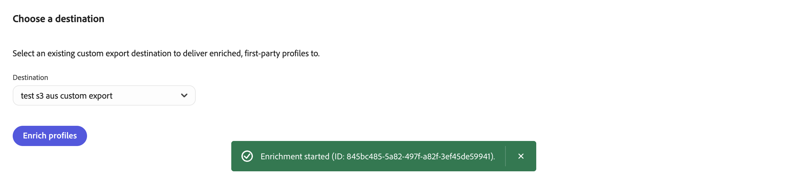

# O enriquecimento do perfil da Trade Desk (Alpha)

Use o feed de dados de log de impressão do REDS (Fluxo de Dados de Eventos Brutos) de [!DNL The Trade Desk] para exportar atributos de enriquecimento e contexto de mídia paga para seus perfis primários.

Depois que o arquivo CSV chegar ao destino de exportação do [!DNL Amazon S3], assimile-o no [!DNL Adobe Real-Time CDP]. Nesta versão, a exportação do arquivo não atualiza os perfis nem ativa as experiências automaticamente. O enriquecimento automatizado do perfil de volta para [!DNL Adobe Real-Time CDP] será um recurso em uma versão subsequente.

A exposição do anúncio adiciona contexto aos perfis do cliente. Isso não confirma o engajamento, a intenção de compra ou interesses de longo prazo.

## Preparar para enriquecimento {#prepare-for-enrichment}

Antes de começar, trabalhe com o administrador, a equipe de mídia e a equipe de dados para garantir que você tenha:

* Acesso a [!DNL Adobe Real-Time CDP Collaboration] e um contrato de participação assinado.
* Uma carta de acesso foi concluída com [!DNL The Trade Desk] para autorizar o provisionamento do feed REDS.
* Públicos primários disponíveis em [!DNL Adobe Real-Time CDP Collaboration] que usam endereços de email com hash ou números de telefone com hash. Outros identificadores não são compatíveis nesta versão.
* Um destino [!DNL Amazon S3] configurado para receber saída de enriquecimento.
* Um processo para assimilar o arquivo entregue em [!DNL Adobe Real-Time CDP].

### Autorizar o feed de origem {#authorize-source-feed}

Preencha a carta de acesso fornecida por [!DNL The Trade Desk] para autorizar [!DNL The Trade Desk] a enviar logs de REDS diretamente para a Adobe.

[!DNL The Trade Desk] provisiona o feed de origem e o Adobe configura o acesso e a assimilação. Antes de criar um projeto, confirme se a conexão está ativa e se o feed está pronto.

Após o processamento, o arquivo de saída de enriquecimento chega ao destino de exportação.

### Preparar assimilação downstream {#prepare-downstream-ingestion}

Após a entrega, peça ao administrador ou à equipe de suporte técnico do [!DNL Adobe Real-Time CDP] para assimilar o arquivo.

## Conectar e criar projetos {#connect-create-projects}

Preencha a carta de acesso na caixa de diálogo de conexão e salve sua ID de parceiro. Aguarde a Adobe confirmar o recebimento dos registros REDS antes de criar um projeto. A criação de um projeto inicia o trabalho de enriquecimento, que requer a ID do parceiro e os logs.

### Conectar-se ao parceiro {#connect-partner}

Conecte-se a [!DNL The Trade Desk] e adicione suas informações do anunciante:

1. Em **[!UICONTROL Conectar]**, abra **[!UICONTROL Descobrir colaboradores]**.
1. Pesquisar por [!DNL The Trade Desk].
   ![O catálogo do colaborador lista [!DNL The Trade Desk] e sua opção [!UICONTROL Conectar].](../../../assets/collaborate/advertising-platforms/discover-collaborators-trade-desk.png){zoomable="yes"}
1. Selecione **[!UICONTROL Conectar]** para [!DNL The Trade Desk] e siga as instruções na caixa de diálogo de conexão.
   ![A caixa de diálogo de conexão explica a autorização REDS e a configuração da ID do Parceiro para [!DNL The Trade Desk].](../../../assets/collaborate/advertising-platforms/trade-desk-connection-instructions.png){zoomable="yes"}
1. Depois que a conexão estiver ativa, abra **[!UICONTROL Configurações de conexão]**. Em **[!UICONTROL Informações do anunciante]**, selecione **[!UICONTROL Editar]** para atualizar informações existentes ou **[!UICONTROL Adicionar]** para inserir novas informações.
   ![As configurações de conexão ativa mostram [!UICONTROL Informações do anunciante] e o controle [!UICONTROL Editar].](../../../assets/collaborate/advertising-platforms/trade-desk-connection-settings.png){zoomable="yes"}
1. Insira a ID do parceiro e o nome do parceiro em **[!UICONTROL ID do parceiro]** e **[!UICONTROL Nome do parceiro]** e selecione **[!UICONTROL Salvar]**. Encontre a ID de parceiro na conta [!DNL The Trade Desk] em **[!UICONTROL Identificadores de vaga]**.
   ![A caixa de diálogo Informações do anunciante tem campos de ID do parceiro e nome do parceiro obrigatórios e um controle [!UICONTROL Salvar].](../../../assets/collaborate/advertising-platforms/trade-desk-advertiser-partner-info-dialog.png){zoomable="yes"}

Depois que a conexão estiver ativa e você salvar as informações do anunciante, aguarde a confirmação de que a Adobe recebeu seus registros REDS. Em seguida, crie um projeto.

### Criar um projeto {#create-project}

Crie um projeto para a conexão:

1. Em **[!UICONTROL Colaborar]**, selecione **[!UICONTROL Meus Projetos]**.
1. Selecione **[!UICONTROL Criar um projeto]** ou o ícone adicionar ().
1. Em **[!UICONTROL Criar projeto]**, selecione [!DNL The Trade Desk] de **[!UICONTROL Colaborador]**.
   ![O formulário [!UICONTROL Criar projeto] lista [!DNL The Trade Desk] e inclui os campos de nome, descrição e imagem do projeto.](../../../assets/collaborate/advertising-platforms/trade-desk-create-project.png){zoomable="yes"}
1. Insira um **[!UICONTROL Nome do projeto]** e uma **[!UICONTROL Descrição]** e escolha uma imagem para identificar o projeto.
1. Selecione **[!UICONTROL Criar]**.

Para obter o gerenciamento geral de projetos, consulte o [Guia de Criação e Gerenciamento de Projetos](/help/guide/collaborate/manage-projects.md).

## Selecionar e exportar atributos {#select-export-attributes}

Exportar atributos de enriquecimento do seu projeto:

<!-- TODO: Replace the destination screenshot with one showing the [!UICONTROL Export Attributes] action. -->

1. Abra o projeto e selecione **[!UICONTROL Enriquecer]**.
1. Revise os valores de cobertura para cada atributo para entender a disponibilidade de sinal.
1. Selecione os atributos que deseja usar para enriquecimento.
   ![A página [!UICONTROL Enriquecer] agrupa os sinais selecionáveis por categoria e exibe os valores de cobertura.](../../../assets/collaborate/advertising-platforms/enrich-attribute-selection.png){zoomable="yes"}
1. Selecione o destino de exportação [!DNL Amazon S3] configurado para a saída de enriquecimento. Para configurar um destino, consulte [Configurar e gerenciar destinos de armazenamento na nuvem](/help/guide/destinations/manage-destinations.md).
   <!-- ![The [!UICONTROL Choose a destination] screen lists a destination and the [!UICONTROL Export Attributes] action.](../../../assets/collaborate/advertising-platforms/enrich-choose-destination.png){zoomable="yes"} -->
1. Revise os atributos e o destino selecionados e selecione **[!UICONTROL Exportar atributos]**.
   <!-- {zoomable="yes"} -->

O envio de uma exportação inicia o delivery se o destino estiver configurado corretamente. Verificar entrega de arquivo bem-sucedida fora de [!DNL Adobe Real-Time CDP Collaboration].

O Adobe processa atributos de enriquecimento ao criar um projeto e depois semanalmente. Cada execução usa os últimos 90 dias dos dados [!DNL The Trade Desk] disponíveis. Cada exportação inclui os atributos selecionados na execução concluída mais recente. Para exportar atributos atualizados, solicite outra exportação depois que uma execução posterior for concluída.

### Sinais de enriquecimento disponíveis {#available-signals}

Selecione entre 18 sinais preparados em quatro categorias. Não há suporte para expressões de enriquecimento personalizadas.

| Categoria | Sinal | Descrição |
| --- | --- | --- |
| Núcleo | [!UICONTROL Última data de exposição] | A data em que uma identidade foi exposta mais recentemente a um anúncio. |
| Núcleo | [!UICONTROL Contagem de exposição] | Uma categoria de frequência de exposição, em vez de uma contagem de impressões brutas. |
| Núcleo | [!UICONTROL Prospecção vs redirecionamento] | Uma classificação inferida de exposição como prospecção ou recomercialização. |
| Núcleo | [!UICONTROL Categoria de produto mostrada] | Uma categoria inferida para os produtos promovidos nos anúncios. |
| Núcleo | [!UICONTROL Canal de inventário dominante] | O principal canal de inventário associado à exposição do anúncio. |
| Núcleo | [!UICONTROL Tipo de dispositivo dominante] | O principal tipo de dispositivo associado à exposição do anúncio. |
| Geografia | [!UICONTROL Cidade] | Informações de cidade derivadas do contexto de publicidade, não um local verificado. |
| Geografia | [!UICONTROL Região/Estado] | Informações de região ou estado do contexto de publicidade. |
| Geografia | [!UICONTROL DMA] | Informações sobre a área de mercado designada (DMA) derivadas do contexto de publicidade. |
| Televisão conectada (CTV) | [!UICONTROL CTV exposto] | Exposição do anúncio em um dispositivo de televisão conectado. |
| Televisão conectada (CTV) | [!UICONTROL Visualizador de fluxo ao vivo] | Exposição do anúncio no inventário de transmissão ao vivo, não em prova de visualização ou envolvimento. |
| Televisão conectada (CTV) | [!UICONTROL PMP / exposição premium] | Exposição a um mercado privado (PMP) ou a um contrato privado, não verificada de forma independente no inventário de prêmios. |
| Afinidade de conteúdo | [!UICONTROL TV/Streaming Conectada] | Exposição do anúncio associada ao conteúdo de transmissão. |
| Afinidade de conteúdo | [!UICONTROL Jogador] | Exposição do anúncio associada a conteúdo de jogos, sites ou aplicativos. |
| Afinidade de conteúdo | [!UICONTROL Fã esportivo] | Exposição do anúncio associada a conteúdo esportivo, sites ou aplicativos. |
| Afinidade de conteúdo | [!UICONTROL Seguidor de notícias] | Exposição do anúncio associada a conteúdo de notícias, sites ou aplicativos. |
| Afinidade de conteúdo | [!UICONTROL Amante de músicas] | Exposição do anúncio associada a conteúdo de música, sites ou aplicativos. |
| Afinidade de conteúdo | [!UICONTROL Gênero de conteúdo] | O gênero de conteúdo associado à exposição do anúncio. |

Os sinais geográficos descrevem o contexto de publicidade em vez de uma casa ou localização atual verificada. Os sinais de afinidade de conteúdo não confirmam interesses ou preferências pessoais. Alguns atributos podem não conter valores quando as informações de origem não estão disponíveis.

### Cobertura de atributo {#attribute-coverage}

Cobertura descreve a frequência com que os registros processados incluem um valor de atributo. Para sinais sim/não, como **[!UICONTROL CTV exposto]**, a cobertura conta registros com um valor verdadeiro. A cobertura não indica taxas de correspondência de identidade ou a proporção de perfis primários que receberão um atributo.

A correspondência de identidade, a disponibilidade do sinal de origem e a assimilação afetam as atualizações do perfil. A cobertura não confirma a conclusão da exportação ou as atualizações do perfil.

### Escopo do fluxo de trabalho {#workflow-scope}

Use o catálogo preparado para enriquecer dados de [!DNL The Trade Desk]. Não é possível exportar logs brutos ou criar expressões de atributo personalizadas. Outras integrações da plataforma do lado da demanda (DSP) e da plataforma do lado do suprimento (SSP) não são compatíveis.

Este fluxo de trabalho não é compatível com a descoberta de oportunidades de enriquecimento, análise de sobreposição de público ou medição de atribuição e incrementalidade.

## Assimilar e validar resultados {#ingest-validate-results}

Após a entrega, peça ao administrador ou à equipe de suporte técnico do [!DNL Adobe Real-Time CDP] para assimilar o arquivo.

### Arquivo de saída {#output-file}

A exportação entrega um arquivo CSV para o destino [!DNL Amazon S3] configurado.

<!-- 
TODO: replace this placeholder with the engineering-confirmed output specification:
* Required hashing and normalization for each identifier, including whether email requires SHA-256 after trimming and lowercasing.
* Exact CSV headers, the file naming pattern, and the delivery bucket and path.
* Each identifier column in the delivered file and the identity namespace to map that column to during ingestion.
Do not treat example formats or supported input match keys as confirmed output requirements.
-->

Verifique a exportação separadamente das atualizações de perfil:

1. Confirme se o arquivo CSV chegou ao local [!DNL Amazon S3] desejado.
1. Verifique se o arquivo contém os identificadores esperados e os atributos selecionados.
1. Assimile o arquivo usando a identidade confirmada e os mapeamentos de esquema para a sandbox e o conjunto de dados de destino.
1. Revise os resultados da assimilação e verifique se uma amostra dos perfis esperados contém os atributos de enriquecimento.

A exportação de um arquivo não confirma que a assimilação atualizou os perfis. Assimile cada exportação posterior separadamente para atualizar perfis.

## Solução de problemas de enriquecimento {#troubleshoot-enrichment}

Use essas verificações para solucionar problemas de dados de origem, exportação e assimilação:

| Problema | O que verificar |
| --- | --- |
| A conexão ou **[!UICONTROL Enriquecer]** não está disponível | Peça ao administrador para confirmar a conexão e o acesso ao projeto. Confirme se a configuração do feed de origem foi concluída. |
| Nenhum destino de exportação disponível | Peça ao administrador para confirmar se um destino está configurado e disponível para a saída de enriquecimento. |
| Um atributo tem cobertura limitada | Analise a disponibilidade dos dados de origem com a equipe de mídia. Não interprete a cobertura como uma taxa de correspondência de perfil. |
| Uma exportação foi solicitada, mas nenhum arquivo está presente | Verifique o destino pretendido com sua equipe de dados. O envio da solicitação não confirma a entrega. |
| Um arquivo entregue não atualizou perfis | Revise os resultados da assimilação e confirme a identidade e os mapeamentos de esquema. A exportação e a assimilação são operações separadas. |
| Não é possível solicitar uma exportação | Selecione pelo menos um atributo e um destino. Se uma exportação já estiver sendo processada, aguarde até que ela seja concluída antes de solicitar outra. |
| A cobertura é alta, mas poucos perfis recebem atributos | A cobertura não é uma taxa de correspondência de identidade. Confirme se o feed de origem está pronto, se o público-alvo usa chaves de correspondência compatíveis e se o mapeamento de identidade está correto durante a assimilação. |
| Nenhum atributo ou cobertura é exibido após a criação de um projeto | A configuração do projeto é corrigida ao criá-lo. Se a Adobe não tiver recebido seus logs REDS de [!DNL The Trade Desk] no momento, o projeto não poderá usá-los posteriormente. Depois que a Adobe confirmar o recebimento dos logs, crie um novo projeto. |
| Os perfis têm os atributos, mas um público-alvo ou experiência não os reflete | Verifique a avaliação do público-alvo, a identidade, o consentimento e as regras de direcionamento da experiência downstream. |

## Próximas etapas {#next-steps}

Depois de assimilar e validar os atributos, compile os públicos-alvo no [!DNL Adobe Real-Time CDP] combinando sinais de enriquecimento com dados primários. Para obter mais informações, consulte o [guia do Audience Builder](https://experienceleague.adobe.com/pt-br/docs/experience-platform/segmentation/ui/audience-builder){target="_blank"}.

Para ativar públicos-alvo para destinos, personalização ou jornadas do cliente, consulte o [guia de ativação de público-alvo](https://experienceleague.adobe.com/pt-br/docs/experience-platform/destinations/ui/activate/activation-overview){target="_blank"}.
