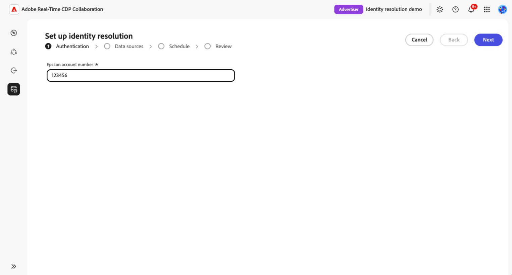
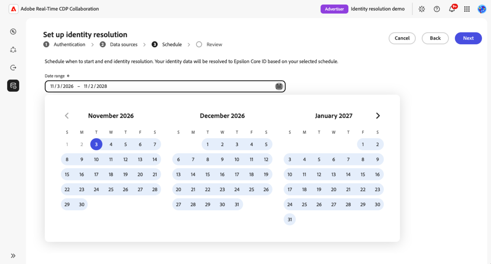

# Configurar e gerenciar a resolução de identidade

{{limited-availability-release-note}}

A resolução de identidade ajuda a identificar os clientes que você tem em comum com os colaboradores, mesmo quando suas organizações usam identificadores diferentes. Configure e gerencie a resolução de identidades com provedores de identidade compatíveis no Real-Time CDP Collaboration, sem criar integrações personalizadas para cada parceiro.

>[!NOTE]
>
>As etapas e capturas de tela neste guia usam [!DNL Epsilon Core ID] como exemplo. Os requisitos e as opções disponíveis podem diferir, dependendo do seu provedor de identidade.

>[!AVAILABILITY]
>
>Na inicialização, somente [!DNL Epsilon Core ID] está disponível para configuração. A resolução de identidade da Epsilon Core ID só está disponível para contas do Real-Time CDP Collaboration provisionadas nos Estados Unidos.

## Pré-requisitos {#prerequisites}

Antes de começar, verifique se você tem:

* **Permissões de gerenciamento de conta.** Você deve ter permissões de **[!UICONTROL Gerenciar conta]** e **[!UICONTROL Gerenciar instâncias do Collaboration]**.
* **Pelo menos uma conexão de dados de público-alvo.** Você precisa de uma conexão de dados de público-alvo existente para configurar a resolução de identidade. [Configurar a fonte de público-alvo](./source-overview.md), se necessário. Não há suporte para conexões de dados de medição.
* **Chaves e campos de correspondência com suporte.** Cada conexão de dados de público-alvo que você pretende usar para a resolução de identidade deve conter campos compatíveis com seu provedor de identidade. Para a Epsilon Core ID, você pode usar email com hash, telefone com hash ou nome combinado com o endereço postal.

  As chaves de correspondência no nível da conta, como email com hash e telefone com hash, devem ser ativadas para a sua conta e mapeadas para os dados do público-alvo. Os campos de nome e endereço postal são mapeados durante a configuração da conexão de dados de público-alvo e não exigem ativação no nível da conta.

  Se estiver usando o nome e o endereço postal, mapeie pelo menos um campo de cada grupo:

  * **Nome:** Nome, sobrenome ou nome completo.
  * **Endereço postal:** Endereço, cidade, CEP, estado ou país.

  Os valores de nome e endereço postal não têm hash. Para obter instruções sobre como habilitar chaves de correspondência em nível de conta, como email com hash e telefone com hash, consulte [Editar chaves de correspondência](./onboard-account.md#edit-match-keys). Para mapear chaves de correspondência suportadas ou campos de nome e endereço postal para seus dados de público-alvo, consulte [Mapear campos](./onboard-audiences.md#map-fields).
* **Número de conta Epsilon.** Obtenha o número da sua conta Epsilon junto ao seu representante de conta Epsilon.

## Configurar resolução de identidade {#configure-identity-resolution}

Selecione um provedor de identidade para começar a configurar a resolução de identidade. Neste exemplo de [!DNL Epsilon Core ID], você fará a autenticação com o provedor, selecionará conexões de dados de público-alvo, definirá um intervalo de datas e revisará sua configuração antes de confirmar.

Para começar, selecione **[!UICONTROL Configuração]** na navegação à esquerda seguida pela guia **[!UICONTROL Resolução de identidade]** para exibir os provedores de identidade disponíveis.

### Selecionar um provedor de identidade {#select-identity-provider}

Localize o cartão do seu provedor de identidade, analise a região com suporte e faça a correspondência das chaves. Selecione **[!UICONTROL Instalação]** para começar.

{zoomable="yes"}

Antes de iniciar o fluxo de trabalho de configuração, o Collaboration verifica se há uma conexão de dados e chaves de correspondência compatíveis. Se um requisito estiver ausente, uma caixa de diálogo será exibida para orientar o processo. Siga a ação na caixa de diálogo:

* **[!UICONTROL Conexão de dados necessária]:** Selecione **[!UICONTROL Configurar conexão de dados]** para configurar uma conexão de dados de público-alvo. Consulte [Conectar uma origem](./source-overview.md#connect-a-source).
* **[!UICONTROL Chave de correspondência necessária]:** Selecione **[!UICONTROL Editar chaves de correspondência]** para habilitar uma chave com suporte. Consulte [Editar chaves de correspondência](./onboard-account.md#edit-match-keys).

Se ambos estiverem ausentes, a caixa de diálogo de conexão de dados será exibida primeiro. Após corrigir os pré-requisitos, volte para **[!UICONTROL Resolução de identidade]** e selecione **[!UICONTROL Instalação]** novamente.

### Autenticar com seu provedor de identidade {#authenticate-with-provider}

Na etapa **[!UICONTROL Autenticar]**, forneça as informações necessárias para seu provedor de identidade. Para a Epsilon Core ID, insira o número da conta fornecido pelo seu representante Epsilon no campo **[!UICONTROL Número da conta Epsilon]**. Clique em **[!UICONTROL Avançar]** para continuar.

{zoomable="yes"}

### Selecionar conexões de dados {#select-data-connections}

Em seguida, escolha quais conexões de dados de público-alvo você deseja usar para a resolução de identidade. Isso determina quais dados de público-alvo serão usados para corresponder as identidades do cliente com seu provedor de identidade. A resolução de identidade usa automaticamente os identificadores compatíveis mapeados em cada conexão selecionada.
Em seguida, escolha quais conexões de dados de público-alvo você deseja usar para a resolução de identidade. As conexões selecionadas determinam quais dados de público-alvo e campos mapeados estão disponíveis para a resolução de identidade.

A resolução de identidade se aplica a todos os públicos-alvo em cada conexão de dados selecionada, incluindo qualquer público-alvo adicionado posteriormente. Não é possível selecionar públicos-alvo individuais no momento.

Se a conexão desejada não estiver listada, [configure a conexão de dados de público-alvo](./source-overview.md) antes de continuar.

Em **[!UICONTROL Fontes de dados]**, marque a caixa de seleção para cada conexão que você deseja incluir em **[!UICONTROL Fontes de público-alvo]**. Você deve selecionar pelo menos uma conexão. Clique em **[!UICONTROL Avançar]** para continuar.

{zoomable="yes"}

### Definir um agendamento de resolução de identidade {#set-schedule}

Escolha as datas de início e término para definir o período durante o qual o Adobe atualiza as IDs dos parceiros. A frequência de atualização é determinada pelas conexões de dados do público-alvo selecionado, portanto, não é possível configurar uma frequência de atualização separada para a resolução de identidade.

Na etapa **[!UICONTROL Agendar]**, selecione o controle de calendário em **[!UICONTROL Intervalo de datas]** e escolha suas datas. Clique em **[!UICONTROL Avançar]** para continuar.

{zoomable="yes"}

### Revise e confirme a configuração {#review-and-confirm}

Na etapa **[!UICONTROL Revisar]**, verifique os detalhes de autenticação, as conexões de dados do público-alvo selecionado e o agendamento. Para fazer alterações, selecione **[!UICONTROL Editar]** ao lado da seção relevante.

Não é possível editar a configuração após a instalação. Para fazer alterações posteriormente, você deve excluí-la e configurá-la novamente. Quando estiver satisfeito com suas seleções, selecione **[!UICONTROL Confirmar e agendar]**.

{zoomable="yes"}

Uma caixa de diálogo de confirmação indica que a resolução de identidade foi configurada com êxito.

<!-- [Question: Does the first identity resolution run happen immediately after setup, or at the next scheduled audience data connection refresh?] -->

## Gerenciar resolução de identidade {#manage-identity-resolution}

Após confirmar a configuração, você retornará automaticamente para a guia **[!UICONTROL Resolução de identidade]**, na qual poderá exibir ou excluir sua configuração.

### Exibir detalhes da configuração {#view-configuration-details}

Para examinar sua configuração, selecione **[!UICONTROL Exibir detalhes]** no cartão do provedor de identidade configurado.

Revise os detalhes de autenticação, as conexões de dados do público-alvo selecionado e o intervalo de datas. Você também pode visualizar as chaves de correspondência exibidas nos detalhes da configuração, juntamente com o status da configuração e as informações de criação e atualização.

{zoomable="yes"}

### Alterar uma configuração existente {#edit-configuration}

Não é possível editar uma configuração da ID principal após a instalação. Para alterar o número de conta Epsilon, as conexões de dados selecionadas ou o intervalo de datas, [exclua a configuração](#delete-configuration) e conclua o [fluxo de trabalho de instalação](#configure-identity-resolution) novamente.

<!-- Question: Do other providers have the same limitation? -->

### Excluir uma configuração de resolução de identidade {#delete-configuration}

Para excluir uma configuração, navegue até **[!UICONTROL Configuração]** > **[!UICONTROL Resolução de identidade]** e selecione **[!UICONTROL Excluir]** no cartão do provedor de identidade configurado. Revise a caixa de diálogo de confirmação e selecione **[!UICONTROL Excluir]** para confirmar.

Se quiser usar este provedor de identidade novamente, você precisará [definir uma nova configuração](#configure-identity-resolution).

<!-- [UNVERIFIED: Does deletion affect previously resolved identifiers, future processing, or both? Confirm before publication.] -->

## Solução de problemas de configuração {#troubleshoot}

Se não for possível iniciar a instalação porque uma conexão de dados ou chave de correspondência está ausente, siga as instruções em [Selecione um provedor de identidade](#select-identity-provider).

Para a Epsilon Core ID, verifique o seguinte:

* **Não disponível em sua região:** A Epsilon Core ID está disponível somente para contas do Collaboration provisionadas nos Estados Unidos.
* **Número de conta Epsilon indisponível:** Entre em contato com o representante Epsilon para obter o número de conta.
