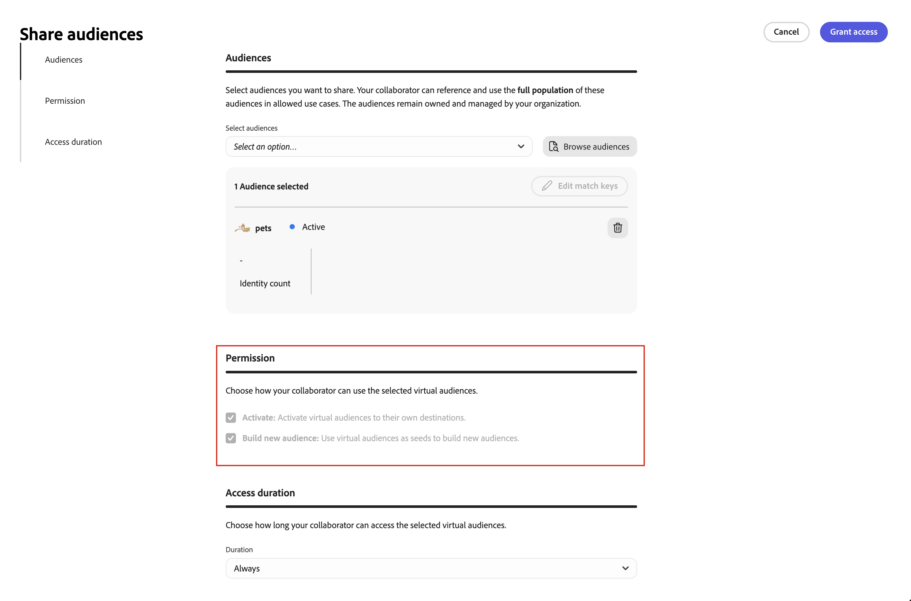

# Acesso virtual de público (concessões de público) para RMN {#virtual-audience-access}

Para compartilhar públicos com parceiros conectados, use o acesso de público virtual no [!DNL Adobe Real-Time CDP Collaboration]. Uma concessão de público-alvo concede ao parceiro acesso a toda a população de público-alvo por meio de uma referência persistente. Você mantém a propriedade e nenhum dado de público é movido ao conceder acesso.

Para usar um público-alvo compartilhado, encontre o público-alvo virtual no inventário. Use o público-alvo para ativação ou criação de público-alvo de coorte dentro das permissões de concessão. Por exemplo, uma rede de mídia de varejo (RMN) pode conceder aos anunciantes acesso à criação e ativação de públicos-alvo de coorte.

## Conceitos de acesso ao público-alvo {#audience-access-concepts}

Para entender o que você compartilha e como um parceiro pode usar o público-alvo, leia os termos a seguir.

| Termo | Descrição |
| --- | --- |
| Provedor | A organização que possui o público-alvo e controla o acesso. |
| Recipient | O parceiro conectado que recebe acesso ao público-alvo. |
| Conceder | Acesso a um público-alvo compartilhado, incluindo usos permitidos e duração do acesso. |
| Público virtual | Uma referência persistente a um público-alvo de propriedade de provedor, disponível no inventário do recipient. |
| População Completa | Compartilhamento que concede acesso a toda a população de público-alvo. |
| Escopo da conexão | Acesso que se aplica à conexão entre o provedor e o recipient, em vez de um único projeto. |

{style="table-layout:auto"}

Para ativar um público-alvo compartilhado, você precisa de permissão de ativação direta.

O acesso de público-alvo virtual se aplica a uma conexão. O compartilhamento em um projeto é um fluxo de trabalho separado e não adiciona públicos-alvo virtuais ao inventário do recipient.

Para ativar públicos-alvo por meio de um projeto de colaboração existente, consulte [Enviar e ativar públicos-alvo em um projeto](/help/guide/collaborate/activate.md).

## Pré-requisitos {#prerequisites}

Antes de conceder ou usar acesso de público-alvo virtual, confirme se você atende aos seguintes requisitos.

* Para concessões de público-alvo virtual, estabeleça uma conexão [ativa com seu colaborador](/help/guide/connect/establishing-connections.md).
* Se você fornecer um público-alvo, confirme se ele está disponível para compartilhamento.
* Para confirmar quais ações estão disponíveis, revise as permissões de concessão para públicos-alvo compartilhados com você.

A caixa de diálogo **[!UICONTROL Compartilhar públicos-alvo]** exibe as seguintes permissões. Ambas as permissões estão selecionadas e indisponíveis para edição.

| Permissão de público | Uso permitido |
| --- | --- |
| Ativação direta | Ative um público-alvo compartilhado para um destino sem um projeto quando o público-alvo atender aos requisitos de ativação. |
| [!UICONTROL Criar novo público-alvo] | Use um público-alvo compartilhado como entrada ao criar públicos-alvo. |

{style="table-layout:auto"}

## Compartilhar um público {#share-an-audience}

Para conceder a um parceiro conectado acesso a públicos selecionados, conceda acesso a toda a população e defina os usos e a duração permitidos. Conceder acesso não ativa os públicos.

Primeiro, abra o espaço de trabalho **[!UICONTROL Connect]** e a conexão do recipient.

Em seguida, selecione **[!UICONTROL Acesso ao público-alvo]** e escolha a opção para os públicos-alvo que você compartilha com o parceiro.

A opção inclui o nome do parceiro. Neste exemplo, selecione **[!UICONTROL Para FrameSix Media]**.

Em seguida, selecione **[!UICONTROL Conceder acesso]** para abrir a caixa de diálogo **[!UICONTROL Compartilhar públicos]**.

Em **[!UICONTROL Públicos-alvo]**, escolha públicos-alvo de **[!UICONTROL Selecionar públicos-alvo]** ou selecione **[!UICONTROL Procurar públicos-alvo]**.

Os públicos-alvo selecionados são exibidos na caixa de diálogo. Sua organização mantém a propriedade e o gerenciamento dos públicos-alvo.

Em seguida, examine as permissões exibidas em **[!UICONTROL Permissão]**. A permissão de ativação direta permite que o parceiro ative públicos-alvo virtuais para seus próprios destinos. **[!UICONTROL Criar novo público-alvo]** permite que o parceiro use públicos-alvo virtuais para criar novos públicos-alvo. Ambas as permissões estão selecionadas e indisponíveis para edição.

Em seguida, escolha uma opção de **[!UICONTROL Duração]** em **[!UICONTROL Duração do acesso]** para definir por quanto tempo o parceiro terá acesso. Selecione **[!UICONTROL Sempre]** para acesso sem data de expiração ou especifique uma data para acesso limitado por tempo.

Por fim, analise os públicos selecionados, as permissões e a duração do acesso e selecione **[!UICONTROL Conceder acesso]**.

A guia **[!UICONTROL Acesso ao público-alvo]** lista os públicos-alvo compartilhados com seu status, contagem de identidades, duração do acesso, permissões e descrição.

Os públicos-alvo compartilhados também aparecem no inventário de recipients como referências virtuais. Você retém a propriedade. O recipient pode ativar um público-alvo separadamente se a concessão permitir a ativação.

## Encontrar e usar públicos-alvo compartilhados {#find-and-use-shared-audiences}

Como destinatário, localize públicos-alvo compartilhados na guia **[!UICONTROL Acesso ao público-alvo]** da conexão do provedor. Use cada público dentro das permissões de concessão.

### Encontrar públicos-alvo compartilhados {#find-shared-audiences}

Para encontrar públicos-alvo compartilhados por um provedor e revisar seus detalhes de acesso, abra a conexão do provedor. Primeiro, abra o espaço de trabalho **[!UICONTROL Connect]** e a conexão do provedor.

Em seguida, selecione **[!UICONTROL Acesso ao público-alvo]** e escolha a opção para públicos-alvo compartilhados pelo provedor.

A opção inclui o nome do provedor. Neste exemplo, selecione **[!UICONTROL De FrameSix Media]**.

Por fim, analise os públicos-alvo compartilhados e seus detalhes de acesso.

### Criar públicos-alvo {#build-audiences}

Para criar um público-alvo a partir de um público-alvo compartilhado, você precisa da permissão **[!UICONTROL Criar novo público-alvo]**. Por exemplo, combine um público-alvo compartilhado com seu próprio público-alvo para criar um novo público-alvo.

O novo público-alvo pertence a você. O provedor retém a propriedade do público-alvo de origem.

### Ativar públicos-alvo compartilhados {#activate-shared-audiences}

Para ativação direta de um público virtual, confirme se a concessão atende a essas condições.

| Requisito | Condição |
| --- | --- |
| Tipo de compartilhamento | População Completa |
| Permissão de público | Você tem permissão de ativação direta para o público-alvo. |
| Conceder status | Ativo. O acesso é indefinido ou está dentro do intervalo de datas especificado. |

{style="table-layout:auto"}

Para enviar um público qualificado para um destino, use a página **[!UICONTROL Ativar]**. Você não precisa de um projeto.

Para obter mais informações, consulte [Ativar públicos diretamente (Beta)](/help/guide/destinations/direct-audience-activation.md).

Se um público-alvo não atender aos requisitos, você não poderá selecionar o público-alvo para ativação direta. O Collaboration verifica a qualificação novamente em cada execução de ativação agendada.

## Gerenciar o acesso do público {#manage-audience-access}

Como provedor, você controla a duração do acesso. Somente você pode alterar a expiração da concessão ou revogar o acesso.

### Duração do acesso {#access-duration}

Escolha uma duração de acesso ao criar a concessão.

| Duração | Comportamento |
| --- | --- |
| [!UICONTROL Sempre] | Acesso sem expiração automática. Você pode revogar a concessão. |
| Intervalo de datas | O acesso dura o período especificado. A expiração dos processos do Collaboration é de hora em hora. |

{style="table-layout:auto"}

Para estender o acesso, defina uma data de expiração futura ou altere a duração para acesso indefinido. Qualquer uma das alterações também reativa uma concessão expirada.

### Expiração de acesso {#access-expiration}

A Collaboration verifica as concessões expiradas por hora. Quando o Collaboration marca uma concessão como expirada, o recipient perde o acesso virtual ao público-alvo.

### Revogar acesso {#revoke-access}

Para remover o acesso virtual imediatamente, revogue a concessão ativa ou expirada.

## Próximas etapas {#next-steps}

Depois de conceder ou receber acesso ao público-alvo, use os guias a seguir para se preparar para a ativação ou gerenciar conexões do collaborator.

* [Configurar e gerenciar destinos](/help/guide/destinations/manage-destinations.md)
* [Gerenciar conexões do collaborator](/help/guide/connect/manage-connections.md)
